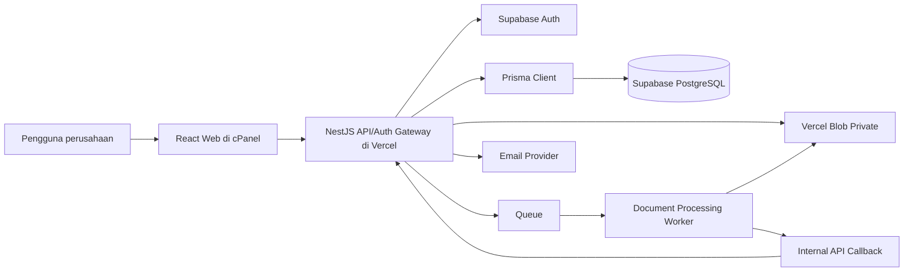
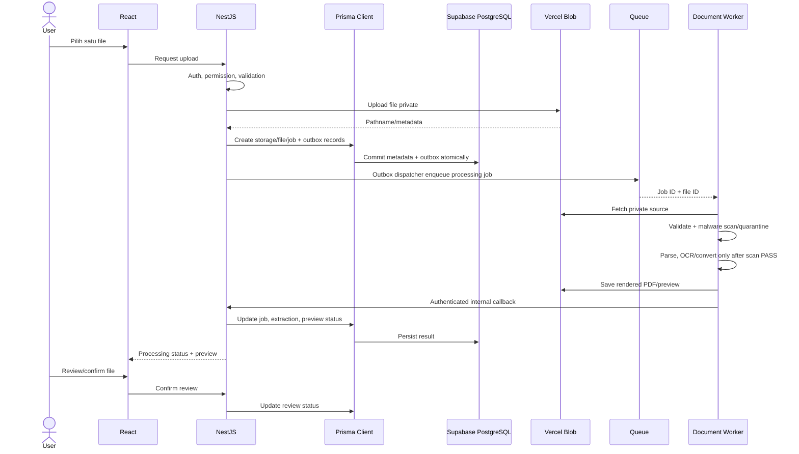

# System Architecture

## Surat Digital

**Versi:** 1.3 — Target architecture

## 1. Ringkasan

| Layer | Teknologi | Tanggung jawab |
|---|---|---|
| Presentation | React di cPanel | UI web responsif |
| API | NestJS di Vercel | Business logic, authorization, API |
| ORM | Prisma Client | Akses tabel aplikasi dan transaksi |
| Database | Supabase PostgreSQL | Data relasional, constraints, RLS |
| Authentication | NestJS Auth Gateway + Supabase Auth | Login/session boundary di backend; Supabase menyimpan identity/password |
| File Storage | Vercel Blob | File asli, preview, evidence, final PDF |
| Queue | Redis + BullMQ (rekomendasi awal) atau managed queue | Dispatch dan retry job |
| Processing | Worker/container terpisah | Parsing, OCR, konversi Office, preview, PDF final |
| Email | Provider transaksional | Notifikasi email |

**Aturan akses database:** semua operasi data aplikasi dari NestJS menggunakan Prisma Client. Supabase JS Client bukan ORM atau jalur query utama tabel aplikasi. Supabase SDK dapat dipakai terbatas untuk Auth.

## 2. Context diagram



## 3. Komponen

### 3.1 React Frontend

- Login/session hanya melalui NestJS auth gateway/BFF. Browser tidak memanggil Supabase Auth secara langsung.
- Dashboard, document wizard, editor, Form Builder.
- Preview dan review file.
- Knowing, approval, signature, archive, dan administration screens.
- Memanggil NestJS untuk seluruh data aplikasi.
- Tidak memegang `DATABASE_URL`, `DIRECT_URL`, service role key, Blob token, atau worker secret.

### 3.2 NestJS API

- Menjadi auth gateway/BFF ke Supabase Auth untuk login, refresh, logout/revoke, reset flow, dan `/auth/me`.
- Menyimpan/menyampaikan session dengan mekanisme yang dipilih (baseline: secure HttpOnly cookie bila feasible) dan menerapkan CSRF/CORS policy yang sesuai.
- Memvalidasi token/session Supabase sebelum setiap protected request.
- Resolve employee aktif berdasarkan `auth_user_id`.
- Menjalankan Group Policy dan backend authorization.
- Menggunakan Prisma Client melalui `PrismaService`.
- Menjalankan transaksi, state machine, canonical manifest, atomic Creator Sign+Submit, numbering, signature, workflow recovery, dan audit.
- Mengelola upload/download Vercel Blob.
- Menulis business state dan transactional outbox dalam transaksi yang sama; dispatcher mengirim processing/finalization/notification job ke queue secara idempotent.
- Menyediakan internal callback yang terautentikasi untuk worker.
- Memastikan seluruh akses resource memeriksa authorization; UUID bukan pengganti authorization.

### 3.3 Prisma ORM

- `schema.prisma` memodelkan tabel aplikasi dan relasi.
- Prisma Client menjadi satu-satunya jalur akses database utama dari NestJS.
- Prisma Migrate mengelola perubahan schema.
- Prisma Seed mengelola data awal.
- PostgreSQL objects yang tidak direpresentasikan penuh di Prisma Schema (RLS policies, triggers, functions, partial indexes tertentu) ditambahkan sebagai SQL kustom di migration Prisma.
- Prisma tidak mengelola tabel internal Supabase Auth seperti `auth.users`; `employees.auth_user_id` menyimpan UUID referensinya.

### 3.4 Supabase PostgreSQL

- Menyimpan master organisasi, employee profile, Group Policy, dokumen, versi, participant, signature metadata, numbering, audit, notification, processing job, dan extraction metadata.
- Menjalankan constraints, indexes, triggers, functions, dan RLS.
- Migration schema aplikasi dijalankan dengan Prisma Migrate.
- Backup dan point-in-time recovery mengikuti paket Supabase yang dipilih.

### 3.5 Supabase Auth

`employees.auth_user_id` menghubungkan employee dengan `auth.users.id`.

- Supabase Auth mengelola identity/password/token primitive; NestJS menjadi boundary session aplikasi yang digunakan browser.
- Username/NIP menggunakan lookup server-side yang aman untuk menemukan identifier login terkait.
- Password tidak disimpan di tabel `employees`.
- Backend memverifikasi JWT sebelum menentukan employee dan permission.
- Auth user dan employee profile memiliki lifecycle yang disinkronkan melalui proses backend.

### 3.6 Vercel Blob

Menyimpan:

- File asli upload.
- PDF hasil konversi/preview.
- Evidence tanda tangan visual.
- PDF final yang diterbitkan.

PostgreSQL menyimpan metadata: provider, pathname, content type, detected MIME, size, SHA-256, status, dan relasi.

Gunakan private access pattern atau authenticated proxy sesuai konfigurasi Blob. URL yang sulit ditebak bukan kontrol keamanan. Token Blob hanya berada di backend/worker.

### 3.7 Document Processing Worker

Worker berjalan sebagai proses/container terpisah dari NestJS API. Tugas:

- Validasi ulang file dan signature file.
- Ekstraksi teks PDF digital menggunakan `pdfjs-dist`.
- Ekstraksi DOCX menggunakan `mammoth`.
- Ekstraksi XLSX/XLS menggunakan `xlsx` (SheetJS).
- Ekstraksi DOC legacy menggunakan LibreOffice atau Apache Tika sesuai hasil proof-of-concept.
- OCR fallback untuk PDF scan menggunakan Tesseract.js atau provider OCR yang dapat diganti.
- Mandatory malware scan/quarantine sebelum parser/converter.
- Konversi DOC/DOCX/XLS/XLSX ke PDF menggunakan LibreOffice headless.
- Membuat preview, menghitung hash, dan mengembalikan hasil melalui internal API callback.
- Tidak menjalankan macro atau konten aktif dari file upload.

Worker harus memiliki batas CPU, RAM, ukuran file, jumlah halaman/sheet, waktu proses, dan ruang temporary. Worker berjalan non-root, membersihkan temporary files, serta tidak mencatat konten dokumen ke log.

## 4. Upload dan processing flow



Upload dilakukan satu per satu. Satu versi dokumen memiliki satu file utama dan dapat memiliki banyak attachment. File belum dapat dikonfirmasi/submit sebelum processing selesai dan preview yang diperlukan tersedia.

## 5. Database access, connection, dan migration

### Runtime

- NestJS memakai `PrismaService`.
- `DATABASE_URL` memakai koneksi runtime Supabase; untuk serverless umumnya transaction pooler.
- Prisma Client harus diinisialisasi dengan pola yang sesuai runtime/serverless agar tidak membuat koneksi berlebihan.
- Semua operasi per-user yang mengandalkan RLS harus berada dalam satu transaction dan menggunakan transaction client yang sama.

### Migration

- `DIRECT_URL` digunakan oleh Prisma CLI/Migrate melalui `prisma.config.ts` sesuai versi Prisma yang dipilih.
- Migration dibuat dengan `prisma migrate dev` pada development dan diterapkan dengan `prisma migrate deploy` pada deployment.
- `schema.prisma` menjadi schema model utama.
- RLS, trigger, function, dan SQL PostgreSQL khusus ditambahkan di file `migration.sql` hasil Prisma Migrate.
- Jangan menggunakan Supabase CLI migration sebagai jalur utama schema aplikasi.

### Connection variables

```env
DATABASE_URL="postgresql://...transaction-pooler..."
DIRECT_URL="postgresql://...direct-or-session-connection..."
```

Nilai asli hanya berada di server environment. Format parameter pooler harus mengikuti connection string aktual Supabase dan versi Prisma/driver yang dipakai.

## 6. RLS dan authorization

- Backend authorization tetap wajib dan menjadi enforcement utama untuk seluruh endpoint aplikasi.
- RLS di PostgreSQL menjadi lapisan defense-in-depth hanya jika runtime DB role tidak memiliki `BYPASSRLS`, bukan owner yang melewati RLS, dan policy cocok dengan role/context.
- Jika policy memakai `auth.uid()`, backend harus mengisi identity claim dari JWT yang sudah diverifikasi dalam transaction-local context (misalnya `set_config('request.jwt.claim.sub', verifiedAuthUserId, true)`), lalu semua query terkait harus menggunakan transaction client yang sama.
- Jangan mengandalkan session-level `SET` di transaction pooler.
- Migration memakai role terpisah dengan hak DDL; runtime role tidak boleh menjadi owner tabel atau `BYPASSRLS`.
- Jika runtime menggunakan role `BYPASSRLS` seperti konfigurasi Prisma privileged yang umum, RLS tidak melindungi query Prisma tersebut. Dalam mode itu, backend authorization wajib menjadi kontrol utama dan dokumen tidak boleh mengklaim sebaliknya.
- Strategi role/context harus dibuktikan dengan integration tests sebelum production. Pada POC, ukur juga latency/transaction complexity antara backend authorization-only pada restricted role versus backend authorization + RLS context; keputusan akhir dicatat di ADR tanpa mengurangi kewajiban backend authorization.

## 7. Finalization flow

Finalization menggunakan prinsip **number reservation before rendering** dan transactional outbox:

1. Semua Knowing selesai dan semua Approver selesai.
2. Dalam satu transaksi Prisma, backend:
   - memvalidasi state dan runtime authorization;
   - mengubah dokumen ke `FINALIZING`;
   - me-reserve nomor resmi menggunakan counter + `offices.timezone`;
   - menyimpan snapshot format/issuer;
   - membuat finalization job record dan outbox event.
3. Commit database selesai.
4. Outbox dispatcher mengirim event ke queue.
5. Worker mengambil canonical version + Document Manifest + nomor reservation.
6. Worker menyusun PDF final dengan nomor resmi dan signature blocks Creator/Knowing/Approver.
7. Worker menyimpan PDF final di Blob dan menghitung SHA-256.
8. Worker mengirim authenticated idempotent callback.
9. NestJS memverifikasi job, manifest/reservation, storage object, dan hash lalu mengubah numbering `RESERVED → ISSUED` dan document `FINALIZING → ISSUED` dalam satu transaksi.
10. Event `DOCUMENT_ISSUED` ditulis ke outbox untuk notification/indexing lanjutan.

Retry selalu menggunakan reservation yang sama. Jika failure dinyatakan permanen/irrecoverable oleh operasi yang berizin, reservation berubah menjadi `VOID` dan **tidak boleh dipakai ulang**.

### 7.1 Canonical Document Manifest

Sebelum Creator Sign+Submit, backend membentuk manifest canonical deterministic yang minimal memuat document/version ID, issuer office/division, document type/subtype, canonical PDF hash, daftar attachment file ID+SHA-256, dan schema/manifest version. Hasil canonical serialization di-hash menjadi `document_manifest_hash`. Semua signature mengikat hash ini.

Creator Sign+Submit dijalankan atomik: validate → build manifest → lock version/files/participants → create Creator signature → transition state → audit/outbox → commit. Tidak ada endpoint/state persisten “sign Creator dulu, submit nanti”.

## 8. Deployment boundaries

| Komponen | Target | Catatan |
|---|---|---|
| React | cPanel perusahaan | Static build |
| NestJS API | Vercel | Request singkat, API dan dispatch job |
| PostgreSQL | Supabase | Prisma Client |
| Blob | Vercel Blob | Private access |
| Worker | Container/VM terpisah | LibreOffice/OCR; hosting final perlu dipilih |
| Queue | Redis/managed queue | BullMQ direkomendasikan untuk Node worker |

Worker berat tidak disarankan dijalankan sebagai request panjang di Vercel Functions. LibreOffice dan OCR memerlukan binary/system dependencies, temporary storage, CPU/RAM, dan waktu proses yang lebih terkontrol.

## 8A. Transactional outbox

`outbox_events` menjadi boundary reliability antara transaksi PostgreSQL dan queue/provider eksternal. Business transaction hanya dianggap siap didispatch jika state bisnis dan outbox event sudah commit bersama. Dispatcher/reconciler dapat publish ulang event berstatus pending/failed dengan idempotency key. Consumer wajib idempotent.

## 9. Failure handling

| Risiko | Mitigasi |
|---|---|
| Vercel function timeout | API hanya dispatch job; worker terpisah |
| Duplicate job | Idempotency key dan unique job identity |
| Worker crash | Retry terbatas dan dead-letter queue |
| Blob upload sukses, DB gagal | Reconciliation/orphan cleanup |
| DB record ada, queue gagal | Outbox/re-dispatch strategy |
| RLS tidak berjalan pada Prisma | Runtime role dan transaction-context tests |
| Service role bypass RLS | Jangan gunakan untuk query runtime Prisma |
| PDF conversion berbeda | Preview dan review wajib |
| OCR tidak akurat | Tampilkan status OCR dan wajibkan pemeriksaan manusia |
| Worker menerima file berbahaya | Isolasi container, malware scan, resource limits |

## 10. Keputusan teknis yang masih perlu proof-of-concept

- Versi Prisma dan driver adapter yang dipakai.
- Bentuk connection string Supabase runtime dan migration.
- Implementasi transaction-local RLS context.
- Hosting worker/container.
- Queue provider.
- Pilihan OCR engine/provider dan bahasa.
- Library PDF final composition.
- Batas ukuran file, halaman, sheet, CPU/RAM, dan timeout.
- Email provider.
- Malware scanner provider/engine dan kapasitas.
- Session cookie/custom-domain strategy untuk frontend cPanel ↔ API Vercel.

## 11. Referensi teknis

- [Supabase — Prisma](https://supabase.com/docs/guides/database/prisma)
- [Prisma — PostgreSQL](https://www.prisma.io/docs/orm/v7/core-concepts/supported-databases/postgresql)
- [Supabase — Row Level Security](https://supabase.com/docs/guides/database/postgres/row-level-security)
- [Supabase — PostgreSQL connections](https://supabase.com/docs/guides/database/connecting-to-postgres)

## 12. External Signing architecture — v1.3

External Signing menggunakan capability terbatas, bukan session internal:

```text
Internal User → NestJS → create external_signing_request
                         ├─ reserve credit
                         ├─ generate high-entropy token
                         ├─ store token hash only
                         └─ dispatch invitation via outbox

External Recipient → Public Web → NestJS public endpoint
                               ├─ validate token/expiry/revocation
                               ├─ optional OTP challenge
                               ├─ allowlisted document review
                               └─ sign transaction
                                      ├─ signature + evidence
                                      ├─ credit reservation CONSUME
                                      ├─ action/audit
                                      └─ outbox event
```

Public endpoints tidak menggunakan employee authorization context. Mereka menggunakan purpose-bound request capability dan tetap menerapkan rate limit, generic errors, object-level checks, token redaction, serta document-version lock.

## 13. Credit Billing architecture — v1.3

Domain billing berada di NestJS dan database; client tidak pernah dipercaya mengirim saldo atau harga authoritative.

Komponen:

- `BillingModule` — plan/subscription lifecycle dan entitlement.
- `CreditModule` — lots, wallet projection, reservation, consume, release, expiry, reconciliation.
- `ExternalSigningModule` — mengintegrasikan credit reservation dengan signing business transaction.
- Payment adapter — provider-neutral; baseline dapat dimulai dari confirmed manual/admin payment, kemudian adapter payment gateway.
- Scheduled allocator/expiry worker — idempotent monthly allocation dan expiry processing.
- Reconciliation job — membandingkan wallet projection dengan ledger/lot/reservation invariants.

Atomicity rule: perubahan business state yang membuat charge final dan perubahan credit reservation/ledger harus berada dalam transaksi database yang sama bila memakai database yang sama. Event downstream dikirim melalui transactional outbox setelah commit.

Credit balance tidak dihitung dari cache sebagai source of truth. Cache boleh digunakan hanya sebagai read optimization setelah reconciliation strategy tersedia.
