# Database Design & ERD

## Supabase PostgreSQL — Surat Digital

**Versi:** 1.3  
**Status:** Baseline konseptual; implementasi schema melalui Prisma

## 1. Prinsip database

- PostgreSQL dikelola melalui Supabase.

- Primary key menggunakan UUID.

- Timestamp menggunakan `timestamptz`.

- Nama tabel dan kolom menggunakan `snake_case`.

- Password dikelola Supabase Auth.

- File fisik disimpan di Vercel Blob.

- PostgreSQL menyimpan metadata file, hash, dan relasi.

- Data perusahaan menggunakan `company_id` untuk konsistensi dan
  isolasi.

- Perubahan schema aplikasi dilakukan melalui Prisma Migrate dengan migration versioned.

## 2. Keputusan ERD

| Keputusan                | Nilai                                  |
|--------------------------|----------------------------------------|
| Perusahaan               | Satu perusahaan pada implementasi awal |
| Kantor                   | 3                                      |
| Divisi                   | 10                                     |
| Divisi lintas kantor     | Didukung                               |
| User                     | ±100                                   |
| Creator sebagai Knowing  | Dilarang                               |
| Creator sebagai Approver | Dilarang                               |
| Knowing dan Approver     | Harus orang berbeda                    |
| File utama               | Tepat satu per versi                   |
| Attachment               | Banyak per versi                       |
| Tracking ID              | UUID dokumen                           |
| Storage                  | Vercel Blob                            |

## 3. Domain dan tabel

Baseline v1.3 terdiri dari **45 tabel aplikasi**: 37 tabel v1.2 ditambah 8 tabel External Signing dan Credit Billing.

### 3.1 Organization (7 tabel)

1.  `companies`

2.  `offices`

3.  `divisions`

4.  `office_divisions`

5.  `job_titles`

6.  `employees`

7.  `employee_assignments`

Relasi:

- Satu company memiliki banyak office dan division.

- Office dan division berelasi many-to-many melalui `office_divisions`.

- Employee dapat memiliki assignment organisasi.

- `employees.auth_user_id` terhubung ke `auth.users.id`.

- `offices.timezone` wajib menyimpan IANA timezone seperti `Asia/Makassar`, bukan offset tetap.

### 3.2 Access Control (4 tabel)

8.  `groups`

9.  `permissions`

10. `employee_groups`

11. `group_permissions`

Relasi:

- Employee dapat berada dalam banyak group.

- Group memiliki banyak permission.

- Permission dapat berstatus ALLOW atau DENY.

- DENY mengalahkan ALLOW.

### 3.3 Document Master dan Storage (3 tabel)

12. `document_types`

13. `document_subtypes`

14. `storage_objects`

`storage_objects` menyimpan metadata file Vercel Blob, bukan binary
file.

### 3.4 Document dan Workflow (9 tabel)

15. `documents`

16. `document_versions`

17. `document_files`

18. `document_participants`

19. `employee_signature_profiles`

20. `document_signatures`

21. `numbering_counters`

22. `document_numberings`

23. `document_actions`

### 3.5 Template dan Form Builder (6 tabel)

24. `document_templates`

25. `template_versions`

26. `form_definitions`

27. `form_versions`

28. `form_fields`

29. `form_submissions`

### 3.6 Supporting System (3 tabel)

30. `notifications`

31. `notification_deliveries`

32. `audit_logs`

### 3.7 Document Processing (2 tabel)

33. `document_processing_jobs`

34. `document_extractions`

### 3.8 Reliability, Recovery, dan Verification (3 tabel)

35. `outbox_events`

36. `workflow_recovery_actions`

37. `document_verification_tokens`

### 3.9 External Signing & Credit Billing (8 tabel)

38. `external_signing_requests`

39. `subscription_plans`

40. `company_subscriptions`

41. `credit_wallets`

42. `credit_lots`

43. `credit_ledger_entries`

44. `credit_reservations`

45. `billing_transactions`

`external_signing_requests` merepresentasikan satu signer slot/invitation dan menyimpan token hash, recipient metadata minimal, expiry, status, signature reference, dan credit reservation reference. `subscription_plans` dan `company_subscriptions` menyimpan catalog/snapshot entitlement. `credit_lots` menyimpan sumber, jumlah, remaining, expiry, dan allocation period. `credit_ledger_entries` adalah journal aplikasi append-only. `credit_reservations` mengunci credit untuk business action yang belum final. `billing_transactions` menyimpan top-up/subscription payment request, amount/currency, provider/manual reference, status, callback idempotency, dan timestamps untuk rekonsiliasi pembayaran.

`document_processing_jobs` menyimpan status dan percobaan job secara idempotent. `document_extractions` menyimpan hasil ekstraksi teks/struktur dan versi parser. `outbox_events` menjamin event/job dapat dire-dispatch setelah commit. `workflow_recovery_actions` menyimpan reason, actor, participant lama/baru, dan timestamp recovery. `document_verification_tokens` menyimpan token hash/purpose/expiry/revocation untuk halaman verifikasi tanpa mengekspos dokumen privat. Konten ekstraksi diperlakukan sama sensitifnya dengan dokumen sumber.

## 4. ERD ringkas

```mermaid
erDiagram
    COMPANIES ||--o{ OFFICES : has
    COMPANIES ||--o{ DIVISIONS : has
    OFFICES ||--o{ OFFICE_DIVISIONS : maps
    DIVISIONS ||--o{ OFFICE_DIVISIONS : maps
    EMPLOYEES ||--o{ EMPLOYEE_ASSIGNMENTS : assigned
    OFFICE_DIVISIONS ||--o{ EMPLOYEE_ASSIGNMENTS : contains

    EMPLOYEES ||--o{ EMPLOYEE_GROUPS : member
    GROUPS ||--o{ EMPLOYEE_GROUPS : includes
    GROUPS ||--o{ GROUP_PERMISSIONS : grants
    PERMISSIONS ||--o{ GROUP_PERMISSIONS : assigned

    EMPLOYEES ||--o{ DOCUMENTS : creates
    DOCUMENT_TYPES ||--o{ DOCUMENTS : classifies
    DOCUMENT_SUBTYPES ||--o{ DOCUMENTS : categorizes
    DIVISIONS ||--o{ DOCUMENTS : issues
    OFFICES ||--o{ DOCUMENTS : issues

    DOCUMENTS ||--o{ DOCUMENT_VERSIONS : versions
    DOCUMENT_VERSIONS ||--o{ DOCUMENT_FILES : files
    STORAGE_OBJECTS ||--o{ DOCUMENT_FILES : stores

    DOCUMENTS ||--o{ DOCUMENT_PARTICIPANTS : involves
    EMPLOYEES ||--o{ DOCUMENT_PARTICIPANTS : assigned
    DOCUMENT_PARTICIPANTS ||--o{ DOCUMENT_SIGNATURES : signs
    DOCUMENT_VERSIONS ||--o{ DOCUMENT_SIGNATURES : binds

    DOCUMENTS ||--o| DOCUMENT_NUMBERINGS : numbered
    NUMBERING_COUNTERS ||--o{ DOCUMENT_NUMBERINGS : allocates

    DOCUMENT_TEMPLATES ||--o{ TEMPLATE_VERSIONS : versions
    FORM_DEFINITIONS ||--o{ FORM_VERSIONS : versions
    FORM_VERSIONS ||--o{ FORM_FIELDS : defines
    FORM_VERSIONS ||--o{ FORM_SUBMISSIONS : receives

    EMPLOYEES ||--o{ NOTIFICATIONS : receives
    NOTIFICATIONS ||--o{ NOTIFICATION_DELIVERIES : sends
    EMPLOYEES ||--o{ AUDIT_LOGS : acts
    DOCUMENT_FILES ||--o{ DOCUMENT_PROCESSING_JOBS : processed_by
    DOCUMENT_FILES ||--o{ DOCUMENT_EXTRACTIONS : extracts

    COMPANIES ||--o| COMPANY_SUBSCRIPTIONS : subscribes
    SUBSCRIPTION_PLANS ||--o{ COMPANY_SUBSCRIPTIONS : selects
    COMPANIES ||--o| CREDIT_WALLETS : owns
    CREDIT_WALLETS ||--o{ CREDIT_LOTS : contains
    CREDIT_WALLETS ||--o{ CREDIT_LEDGER_ENTRIES : journals
    CREDIT_WALLETS ||--o{ CREDIT_RESERVATIONS : reserves
    COMPANIES ||--o{ BILLING_TRANSACTIONS : pays
    BILLING_TRANSACTIONS ||--o| CREDIT_LOTS : funds
    DOCUMENTS ||--o{ EXTERNAL_SIGNING_REQUESTS : requests
    EXTERNAL_SIGNING_REQUESTS ||--o| CREDIT_RESERVATIONS : holds
    EXTERNAL_SIGNING_REQUESTS ||--o| DOCUMENT_SIGNATURES : produces
    DOCUMENTS ||--o{ WORKFLOW_RECOVERY_ACTIONS : recovered_by
    DOCUMENTS ||--o{ DOCUMENT_VERIFICATION_TOKENS : verifies
    DOCUMENTS ||--o{ OUTBOX_EVENTS : emits
```



## 5. Tabel inti dan fungsi

| Tabel                         | Fungsi                                          |
|-------------------------------|-------------------------------------------------|
| `companies`                   | Master perusahaan                               |
| `offices`                     | Kantor pusat dan cabang                         |
| `divisions`                   | Master divisi                                   |
| `office_divisions`            | Relasi divisi dan kantor                        |
| `job_titles`                  | Master jabatan                                  |
| `employees`                   | Profil karyawan dan link Supabase Auth          |
| `employee_assignments`        | Penempatan karyawan                             |
| `groups`                      | Group Policy                                    |
| `permissions`                 | Katalog permission                              |
| `employee_groups`             | Membership pengguna                             |
| `group_permissions`           | Permission Allow/Deny per grup                  |
| `document_types`              | Jenis utama dokumen                             |
| `document_subtypes`           | Subjenis dokumen                                |
| `storage_objects`             | Metadata Vercel Blob                            |
| `documents`                   | Record utama dokumen dan UUID tracking          |
| `document_versions`           | Versi konten dokumen                            |
| `document_files`              | File utama, attachment, rendered PDF, final PDF |
| `document_participants`       | Knowing dan Approver                            |
| `employee_signature_profiles` | Status registrasi TTE internal dan hash PIN     |
| `document_signatures`         | Bukti tanda tangan                              |
| `numbering_counters`          | Counter nomor berdasarkan kombinasi             |
| `document_numberings`         | Nomor resmi dan snapshot kode                   |
| `document_templates`          | Definisi template                               |
| `template_versions`           | Versi template                                  |
| `form_definitions`            | Definisi form                                   |
| `form_versions`               | Versi form                                      |
| `form_fields`                 | Konfigurasi field                               |
| `form_submissions`            | Jawaban form JSONB                              |
| `document_actions`            | Riwayat tindakan bisnis dokumen                 |
| `notifications`               | Notifikasi per penerima                         |
| `notification_deliveries`     | Riwayat channel delivery                        |
| `audit_logs`                  | Audit aktivitas sistem                          |
| `document_processing_jobs`    | Status, retry, dan idempotency job pemrosesan    |
| `document_extractions`        | Hasil ekstraksi teks/struktur dan parser version |
| `outbox_events`                | Transactional event/job dispatch                 |
| `workflow_recovery_actions`    | Audit detail penggantian participant blocked     |
| `document_verification_tokens` | Token hash/purpose untuk verifikasi metadata      |
| `external_signing_requests` | Secure external signer invitation/action state |
| `subscription_plans` | Catalog plan dan monthly allocation |
| `company_subscriptions` | Subscription aktif dan snapshot terms |
| `credit_wallets` | Projection saldo available/reserved |
| `credit_lots` | Lot credit berdasarkan source/expiry |
| `credit_ledger_entries` | Journal mutasi credit append-only |
| `credit_reservations` | Reservation per business action/idempotency key |
| `billing_transactions` | Payment/top-up/subscription transaction & provider reconciliation |

## 6. Struktur penting

### 6.1 `documents`

- `id`: UUID dan sekaligus Tracking ID.

- `company_id`: perusahaan pemilik dokumen.

- `document_type_id` dan `document_subtype_id`.

- `creator_employee_id`.

- `issuer_division_id`.

- `issuer_office_id`.

- `title`, `description`, `status`.

- timestamp submit, issue, reject, cancel, archive.

- alasan reject/withdraw.

### 6.2 `document_versions`

- `document_id`.

- `version_no`.

- `source_method`: TEMPLATE, EDITOR, UPLOAD, FORM.

- `content_hash` untuk payload/source yang relevan.

- `canonical_storage_object_id`.

- `document_manifest_hash` dan `manifest_version`; manifest dibentuk dengan canonical serialization deterministic.

- `is_locked`, `locked_at`.

- `created_by_employee_id`.

### 6.3 `document_files`

`file_role`:

- MAIN

- ATTACHMENT

- RENDERED_PDF

- FINAL_PDF

Partial unique index memastikan satu file MAIN per versi, satu rendered
PDF per versi, dan satu final PDF per versi. Metadata file juga perlu
menyimpan detected MIME, ukuran byte, SHA-256, status processing, status
review, dan referensi preview bila tersedia.

### 6.4 `document_participants`

`participant_role`:

- KNOWING

- APPROVER

Knowing tidak memiliki sequence approval. Approver memiliki
`sequence_no` positif.

Status:

- PENDING

- BLOCKED

- ACTIVE

- ACKNOWLEDGED

- APPROVED

- REJECTED

- CANCELLED

Unique constraint pada `(document_id, employee_id)` membantu mencegah
satu orang mendapatkan dua peran pada dokumen yang sama.

### 6.5 `document_signatures`

Peran:

- CREATOR

- KNOWING

- APPROVER

- EXTERNAL_SIGNER

Metode:

- VISUAL

- INTERNAL

- EXTERNAL_ELECTRONIC

Record mengikat signer, role, versi dokumen, `document_manifest_hash`, metode, timestamp, authentication context, dan evidence. Signer internal menggunakan `employee_id`/`participant_id`; signer eksternal menggunakan `external_signing_request_id`. Check constraint memastikan tepat satu signer source yang berlaku sesuai role. External signer tidak harus memiliki `employee_id`.

### 6.6 Provenance template/form/notification

- `document_versions.template_version_id` nullable menyimpan template version yang benar-benar digunakan.
- `form_submissions.document_id`/`document_version_id` menyimpan hasil dokumen yang berasal dari submission jika applicable.
- `notifications` menyimpan `resource_type`/`resource_id` (atau relasi eksplisit document) agar notification dapat ditelusuri dan di-deduplicate.
- `document_actions` menyimpan correlation/idempotency reference untuk tindakan kritis.

### 6.7 `document_numberings`

Menyimpan nomor resmi dan snapshot:

- kode jenis;

- kode divisi;

- kode kantor;

- bulan;

- tahun;

- nomor urut;

- status reservation/issued/void;

- final PDF hash;

- `format_version` atau snapshot format string yang dipakai;

- `reserved_at`, `issued_at`, `voided_at`, dan `void_reason`.

Snapshot diperlukan agar nomor lama tetap dapat dijelaskan meskipun kode
master berubah.

## 7. Aturan constraint dan index

- UUID primary key pada seluruh tabel utama.

- Unique employee number per company.

- Unique username/email yang dinormalisasi.

- Unique office code per company.

- Unique division code per company.

- Unique pasangan office-division.

- Unique employee-group.

- Unique group-permission.

- Unique document-version number.

- Satu MAIN per document version.

- Satu participant per employee per document.

- Unique `(document_id, sequence_no)` untuk Approver.

- Maksimal satu Approver `ACTIVE` per dokumen melalui partial unique index atau guard database yang setara.

- Unique official number.

- Index untuk `company_id`, status, creator, participant employee,
  document type, dan created_at.

## 8. Trigger dan database functions

Target implementasi database harus menyediakan:

- `updated_at` trigger.

- Validasi company consistency.

- Validasi employee assignment.

- Validasi participant.

- Guard perubahan dokumen setelah submit.

- Guard versi/file terkunci.

- Validasi signature.

- Guard transisi status participant.

- Guard transisi status dokumen.

- Immutable signature/action/numbering identity dan application-level guard agar audit tidak dapat update/delete.

- Permission helper.

- Document access helper.

- Reserve official number sebelum finalization job.

- Finalize document issue menggunakan reservation yang sama.

- Guard agar numbering `VOID`/`ISSUED` tidak dapat di-reuse.

- Outbox insert dilakukan dalam transaksi bisnis yang sama; publisher tidak mengubah business state.


## 9. Prisma ORM, schema, migration, dan seed

### Sumber kebenaran schema

- Supabase menyediakan PostgreSQL.
- NestJS mengakses tabel aplikasi melalui Prisma Client.
- `apps/api/prisma/schema.prisma` mendefinisikan model tabel aplikasi dan relasinya.
- Prisma Migrate adalah jalur utama migration: `prisma migrate dev` untuk development dan `prisma migrate deploy` untuk deployment.
- Prisma Seed (`apps/api/prisma/seed.ts`) adalah jalur utama seed dan harus idempotent.
- `prisma.config.ts` membaca environment variables. Untuk Prisma ORM v7, konfigurasi datasource CLI berada di file konfigurasi Prisma; jangan mengasumsikan URL harus ditulis langsung pada `schema.prisma`.
- `DATABASE_URL` untuk runtime dan `DIRECT_URL` untuk migration/introspection dipisahkan sesuai mode koneksi Supabase dan versi Prisma/driver.
- Tabel `auth.users` dikelola Supabase Auth, bukan dibuat atau dimigrasikan sebagai tabel aplikasi Prisma. `employees.auth_user_id` menyimpan UUID relasinya.

### PostgreSQL objects di luar Prisma Schema

RLS policies, triggers, functions, dan sebagian partial/expression indexes mungkin tidak terwakili sepenuhnya di Prisma Schema. Definisikan model tabel di Prisma Schema, lalu tambahkan SQL kustom ke `migration.sql` yang dihasilkan Prisma Migrate. SQL kustom tersebut tetap harus masuk riwayat Prisma Migrate dan diuji di CI.

Jangan menggunakan `supabase/migrations/*.sql` sebagai alur utama migration schema aplikasi. Folder `supabase/tests` boleh digunakan untuk pgTAP/RLS tests.

### Prisma runtime dan migration roles

Gunakan pemisahan kredensial:

- **Migration role:** memiliki hak DDL yang diperlukan untuk menjalankan Prisma Migrate. Kredensial ini hanya digunakan oleh pipeline/developer yang berwenang.
- **Runtime role:** memiliki hak DML minimum yang diperlukan aplikasi, bukan owner tabel, dan idealnya tidak memiliki `BYPASSRLS`.
- Jangan menggunakan `postgres`/service role sebagai kredensial runtime aplikasi jika tidak diperlukan.
- Jika runtime role memiliki `BYPASSRLS`, semua query Prisma melewati RLS. Backend authorization tetap wajib, dan RLS tidak boleh diklaim sebagai lapisan yang melindungi query tersebut.

### RLS context ketika memakai Prisma

Jika policy memakai `auth.uid()`:

1. NestJS memverifikasi JWT Supabase terlebih dahulu.
2. Ambil `auth_user_id` dari JWT terverifikasi, bukan dari request body.
3. Mulai Prisma interactive transaction.
4. Di dalam transaksi, set claim secara transaction-local, misalnya `set_config('request.jwt.claim.sub', verifiedAuthUserId, true)`.
5. Jalankan semua query yang harus tunduk pada RLS melalui transaction client yang sama.
6. Pastikan policy ditujukan ke database role runtime yang benar dan runtime role tidak bypass RLS.
7. Uji isolasi antar-user, rollback, concurrency, dan transaction pooling.

`set_config(..., true)` bersifat lokal untuk transaksi. Jangan memakai session-level state pada transaction pooler. Prisma tidak otomatis meneruskan JWT Supabase ke PostgreSQL atau mengaktifkan `auth.uid()` hanya karena menggunakan Supabase.

RLS menjadi defense-in-depth. Backend authorization dan Group Policy tetap wajib memeriksa semua akses dan tindakan.

## 10. Document processing data model

### `document_processing_jobs`

Menyimpan:
- `document_file_id`.
- `job_type` (VALIDATE, EXTRACT, OCR, CONVERT, PREVIEW, FINAL_PDF).
- `status` (QUEUED, PROCESSING, SUCCEEDED, FAILED, DEAD_LETTER).
- `attempt_count`, `idempotency_key`, `queued_at`, `started_at`, `completed_at`.
- `worker_version`, `error_code` yang sudah disanitasi, dan correlation ID.

Job tidak menyimpan binary file. Unique/idempotency constraint mencegah pemrosesan ganda yang tidak disengaja.

### `document_extractions`

Menyimpan:
- `document_file_id`.
- `extraction_method` (PDF_TEXT, DOCX_TEXT, OFFICE_TEXT, XLSX_CELLS, OCR).
- `parser_name`, `parser_version`, `language`.
- `extracted_text` dan/atau `structured_content` JSONB (page, paragraph, table, sheet, cell).
- `source_sha256`, `created_at`.

Teks hasil ekstraksi merupakan data rahasia perusahaan. Jangan membuka tabel ini melalui akses browser/Data API. Baca melalui NestJS setelah authorization. Tentukan batas ukuran konten dan strategi indexing/full-text search sebelum production.

## 11. Perhatian pada implementasi

1.  Prisma schema dan seluruh migration harus diuji pada project development sebelum staging/production.

2.  Pastikan seluruh tabel memiliki policy yang sesuai.

3.  Tambahkan test RLS menggunakan beberapa akun dengan permission
    berbeda.

4.  Gunakan migration baru untuk setiap perubahan.

5.  Review transaksi penomoran dan finalisasi.

6.  Pastikan orphaned Blob object dapat dideteksi dan dibersihkan secara
    aman.

7.  Jangan menyimpan token Blob atau PIN plaintext.

## 12. Hal database yang masih perlu dipastikan

- Kode subjenis masuk ke nomor resmi atau tidak. Baseline menggunakan
  kode jenis utama.

- Batas ukuran file dan jumlah attachment.

- Format dan normalisasi employee username/email.

- Apakah satu karyawan dapat memiliki lebih dari satu primary assignment
  dalam periode berbeda.

- Retensi dan penghapusan sesuai kebijakan perusahaan.

- Strategi pencarian full-text dan OCR.

- Pengujian final SQL terhadap versi Supabase yang digunakan.

## 13. Referensi implementasi

Sumber implementasi database berada di:
- `apps/api/prisma/schema.prisma`
- `apps/api/prisma/migrations/`
- `apps/api/prisma/seed.ts`
- `apps/api/prisma.config.ts`
- `supabase/tests/rls/` untuk pgTAP/RLS tests bila digunakan.

Jangan membuat schema aplikasi melalui SQL manual di Supabase Dashboard tanpa migration Prisma yang tercatat. Perubahan darurat harus segera direkonsiliasi menjadi migration Prisma yang dapat direproduksi.

Referensi:
- [Supabase Prisma guide](https://supabase.com/docs/guides/database/prisma)
- [Prisma PostgreSQL connector](https://www.prisma.io/docs/orm/v7/core-concepts/supported-databases/postgresql)
- [Supabase RLS](https://supabase.com/docs/guides/database/postgres/row-level-security)

## 14. Credit Billing & External Signing data model — v1.3

### 14.1 `external_signing_requests`

Field konseptual minimum:

- `id`, `company_id`, `document_id`, `document_version_id`;
- `recipient_name`, encrypted/protected `recipient_contact` sesuai kebutuhan;
- `token_hash`, `token_expires_at`, `revoked_at`;
- `status`: `PENDING`, `ACTIVE`, `COMPLETED`, `REVOKED`, `EXPIRED`;
- `credit_reservation_id`;
- `signature_id` nullable;
- `completed_at`, `created_by`, timestamps;
- optional challenge metadata yang tidak menyimpan OTP plaintext.

Unique/constraint wajib mencegah completed action diproses dua kali. Token plaintext tidak disimpan.

### 14.2 `subscription_plans`

Field minimum: `code`, `name`, `monthly_credit_allocation`, `price_amount`, `currency`, `rollover_multiplier`, `active`, version/effective dates. Historical invoice/subscription tidak boleh berubah hanya karena catalog plan diedit; subscription menyimpan snapshot komersial yang relevan.

### 14.3 `company_subscriptions`

Field minimum: company, plan, status (`TRIAL`, `ACTIVE`, `PAST_DUE`, `CANCELLED`, `EXPIRED`), period start/end, next allocation time, commercial snapshot, dan provider reference jika ada.

### 14.4 `credit_wallets`

Satu wallet per company pada baseline. Menyimpan cached/projection `available_amount` dan `reserved_amount` untuk read cepat; ledger/lots/reservations tetap menjadi basis rekonsiliasi.

### 14.5 `credit_lots`

Setiap grant/allocation/top-up membuat lot:

```text
source_type
original_amount
remaining_amount
expires_at
allocation_period
source_reference
```

Consumption order: `expires_at ASC`, lalu `created_at ASC`. Subscription lot memiliki expiry maksimum akhir billing cycle kedua; top-up baseline 12 bulan; trial mengikuti 30 hari.

### 14.6 `credit_ledger_entries`

Tipe minimal:

`ALLOCATE`, `TOP_UP`, `TRIAL_GRANT`, `ADMIN_GRANT`, `RESERVE`, `RELEASE`, `CONSUME`, `EXPIRE`, `REVERSAL`, `ADJUSTMENT`.

Entry committed tidak di-update/delete dari aplikasi. Setiap entry mempunyai actor/system source, reference type/id, idempotency key, amount delta atau movement semantics, dan correlation/request ID.

### 14.7 `credit_reservations`

Status: `ACTIVE`, `CONSUMED`, `RELEASED`, `EXPIRED`. Reservation menyimpan amount, business purpose, reference, idempotency key, dan breakdown lot allocation bila dibutuhkan agar consume/release deterministik.

Constraint penting:

- unique `(company_id, idempotency_key, purpose)`;
- amount > 0;
- transition terminal tidak dapat diulang;
- reservation tidak boleh melebihi available credit pada transaksi serializable/locking strategy yang dipilih;
- consume/release ledger entries dibuat atomik dengan state transition.

### 14.8 `billing_transactions`

Menyimpan transaksi pembayaran/top-up/subscription secara provider-neutral: `type`, `status`, `amount`, `currency`, `provider`, `provider_reference`, `idempotency_key`, `confirmed_at`, serta raw-provider payload hanya jika benar-benar diperlukan dan sudah diredact/encrypted sesuai policy. Satu payment confirmation yang sama tidak boleh membuat lebih dari satu `credit_lot`.

### 14.9 Credit concurrency

Implementasi harus memakai row lock/atomic conditional update yang terbukti melalui concurrency test. Dua request paralel yang masing-masing mencoba me-reserve last credit tidak boleh keduanya berhasil.
