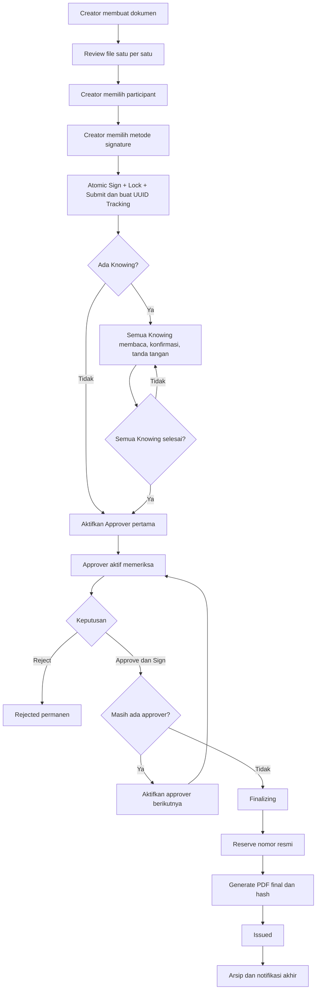
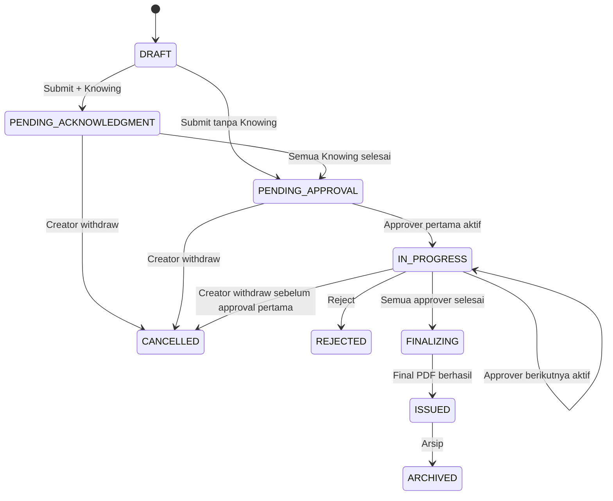

# Workflow & Business Rules

## Surat Digital

**Versi:** 1.3

## 1. Peran dokumen

### Creator

- Membuat dokumen.

- Memilih jenis/subjenis.

- Memilih divisi dan kantor penerbit.

- Memilih Knowing dan Approver.

- Mengatur urutan Approver.

- Menyelesaikan signature sebagai bagian dari tindakan atomik Sign + Lock + Submit.

- Dapat melihat dokumen buatannya.

- Dapat withdraw sebelum persetujuan pertama.

### Knowing

- Harus berbeda orang dari Creator dan Approver.

- Mendapat notifikasi saat awal submit.

- Wajib membaca.

- Wajib menekan konfirmasi membaca.

- Wajib menandatangani.

- Tidak memberikan approval.

- Semua Knowing harus selesai sebelum approver pertama aktif.

- Menerima notifikasi kedua setelah dokumen terbit.

### Approver

- Harus berbeda orang dari Creator dan Knowing.

- Dipilih oleh Creator.

- Memiliki permission yang diperlukan.

- Memproses secara berurutan.

- Wajib melakukan approve dan sign dalam satu tahap.

- Dapat menolak permanen dengan alasan wajib.

## 2. Workflow utama

## 3. Detail tahap

### 3.1 Draft

- Creator membuat dokumen.

- Satu versi dapat memiliki satu file utama dan banyak lampiran.

- File diupload satu per satu.
- Setelah upload, file divalidasi dan diproses secara asynchronous.
- Creator menunggu preview/hasil ekstraksi yang diperlukan, lalu memeriksa dan mengonfirmasi file sebelum melanjutkan upload berikutnya.

- Creator menentukan issuer division dan office.

- Creator memilih Knowing dan Approver.

- Creator memilih metode signature, tetapi signature final belum dibuat terpisah dari submit.

- Draft masih dapat diedit sesuai permission sampai atomic Sign+Submit dimulai.

### 3.2 Submit

Prasyarat:

- Judul dan jenis dokumen valid.

- Satu file utama tersedia.

- Semua file direview/diterima.

- Validasi dan processing file selesai tanpa error blocking.
- PDF canonical/preview tersedia jika file Office.
- Hasil OCR untuk PDF scan (jika dipakai) ditandai sebagai hasil bantu yang harus diperiksa manusia.

- Creator memilih metode signature dan memberikan proof/input yang diperlukan; signature record dibuat server-side dalam transaksi Sign+Submit setelah manifest final dihitung.

- Minimal satu Approver tersedia.

- Creator bukan Knowing/Approver.

- Knowing dan Approver tidak overlap.

- Seluruh participant aktif dan berada dalam perusahaan yang sama.

- Workflow sequence valid.

Atomic Sign+Submit menjalankan: validate → canonical manifest/hash → lock version/files/participants → create Creator signature → state transition → audit/outbox → commit.

Setelah submit:

- UUID menjadi Tracking ID.

- Versi dokumen dikunci.

- Participant dan urutan dikunci.

- Dokumen masuk `PENDING_ACKNOWLEDGMENT` jika ada Knowing.

- Jika tidak ada Knowing, dokumen masuk `PENDING_APPROVAL`.

### 3.3 Knowing

- Semua Knowing mendapatkan notifikasi awal.

- Mereka dapat membaca dan menandatangani secara paralel satu sama lain.

- Masing-masing wajib menyelesaikan read confirmation dan signature.

- Approval belum boleh dimulai sampai seluruh Knowing berstatus
  ACKNOWLEDGED.

- Knowing tidak memiliki tombol approve/reject.

- Jika Creator withdraw sebelum approval pertama, task Knowing menjadi
  cancelled.

### 3.4 Approval

- Approver pertama aktif setelah semua Knowing selesai.

- Approver kedua dan seterusnya berstatus blocked/pending sampai giliran
  aktif.

- Hanya satu approver aktif pada satu waktu.

- Approver memilih metode tanda tangan sendiri. Saat action, sistem memeriksa ulang employee active dan permission yang dipersyaratkan.

- Approve dan sign adalah satu transaksi bisnis.

- Setelah berhasil, approver berikutnya diaktifkan.

- Jika tidak ada approver berikutnya, dalam transaksi final approval sistem masuk `FINALIZING`, me-reserve nomor resmi, dan menulis finalization outbox event sebelum worker membuat PDF final.

### 3.5 Reject

- Hanya approver aktif yang dapat menolak.

- Alasan wajib diisi.

- Status dokumen menjadi REJECTED.

- Proses berhenti.

- Tidak ada nomor resmi yang diterbitkan.

- ID Tracking, signature sebelumnya, dan audit trail tetap tersimpan.

- Nomor yang belum diterbitkan tidak dialokasikan.

### 3.6 Withdraw

- Hanya Creator.

- Hanya sebelum persetujuan pertama selesai.

- Knowing yang sudah menandatangani tidak menghilangkan hak withdraw
  selama belum ada approval pertama.

- Alasan wajib.

- Status CANCELLED.

- Tidak ada nomor resmi.

- ID Tracking dan audit trail tetap tersimpan.

- Setelah approval pertama selesai, Creator tidak dapat withdraw.

### 3.7 Finalizing dan Issued

- Semua approver telah approve dan sign.

- Sistem telah me-reserve nomor resmi secara transaksional sebelum job finalisasi dipublish.

- Worker menyusun PDF final dengan signature blocks Creator, Knowing,
  dan Approver.

- PDF final diupload.

- SHA-256 PDF final dihitung dan disimpan.

- Database melakukan finalization.

- Dokumen menjadi ISSUED.

- Notifikasi kedua dikirim ke Knowing.

- Dokumen dapat masuk arsip.

Jika finalization gagal setelah nomor di-reserve, sistem harus retry menggunakan reservation yang sama. Jangan mengalokasikan nomor baru untuk dokumen yang sama. Jika kegagalan dinyatakan permanen oleh operasi yang berizin, reservation menjadi `VOID` dan tidak boleh digunakan ulang.

## 4. Status dokumen

| Status                 | Makna                              | Perpindahan utama                 |
|------------------------|------------------------------------|-----------------------------------|
| DRAFT                  | Belum diajukan                     | Submit                            |
| PENDING_ACKNOWLEDGMENT | Menunggu semua Knowing             | PENDING_APPROVAL                  |
| PENDING_APPROVAL       | Menunggu aktivasi approver pertama | IN_PROGRESS                       |
| IN_PROGRESS            | Approval berjalan                  | FINALIZING / REJECTED / CANCELLED |
| FINALIZING             | Nomor/PDF final diproses           | ISSUED                            |
| REJECTED               | Ditolak permanen                   | Terminal                          |
| CANCELLED              | Ditarik Creator                    | Terminal                          |
| ISSUED                 | Resmi diterbitkan                  | ARCHIVED                          |
| ARCHIVED               | Arsip                              | Terminal/retention policy         |

## 5. State transition rules

Catatan: `IN_PROGRESS -> CANCELLED` hanya valid apabila belum ada
approval pertama yang selesai. Setelah approval pertama, transition
tersebut harus ditolak.

## 6. Tanda tangan

| Peran    | Tujuan tanda tangan                                 |
|----------|-----------------------------------------------------|
| Creator  | Menyatakan dokumen dibuat dan diajukan oleh Creator |
| Knowing  | Bukti telah membaca dan mengetahui dokumen          |
| Approver | Bukti persetujuan terhadap isi dokumen              |

Metode:

- Visual: dibuat saat penandatanganan.

- Internal: menggunakan profil registrasi aktif dan PIN khusus.

Setiap signer memilih sendiri metodenya. Semua signature mengikat `document_manifest_hash` dari canonical manifest versi terkunci, bukan hanya sebuah file tunggal.

## 7. Penomoran

Format contoh: `025/SK/HRD/CIM/X/2026`

Counter key: `document_type + division + office + month + year`.

Nomor di-reserve setelah seluruh approval selesai **sebelum** worker menyusun PDF final. Bulan dan tahun mengikuti `offices.timezone` berbasis IANA timezone. Nomor `ISSUED` maupun `VOID` tidak digunakan kembali.

## 7A. Runtime permission dan Workflow Recovery

- Participant harus masih `ACTIVE` sebagai employee dan memiliki permission yang diperlukan ketika melakukan action; assignment awal tidak membekukan permission selamanya.
- Jika participant suspended/nonaktif atau permission dicabut, task menjadi `BLOCKED` dan workflow tidak boleh auto-skip.
- Pengguna dengan `Workflow.Repair` dapat mengganti participant blocked dengan participant baru yang valid.
- Recovery wajib reason, menyimpan actor, participant lama/baru, state sebelum/sesudah, request ID, dan timestamp.
- Signature/action historis tidak boleh diubah atau dihapus.
- Sequence Approver tetap dipertahankan; replacement mengambil slot sequence yang sama.

## 8. Notifikasi

| Event                 | Penerima                                                                                                                                                     |
|-----------------------|--------------------------------------------------------------------------------------------------------------------------------------------------------------|
| Submit                | Semua Knowing; approver pertama diberi notifikasi setelah seluruh Knowing selesai. Jika tidak ada Knowing, approver pertama diberi notifikasi setelah submit |
| Knowing task          | Knowing yang bersangkutan                                                                                                                                    |
| Semua Knowing selesai | Approver pertama diaktifkan                                                                                                                                  |
| Approval selesai      | Approver berikutnya                                                                                                                                          |
| Rejected              | Creator dan participant terkait sesuai aturan                                                                                                                |
| Withdraw              | Semua participant terkait                                                                                                                                    |
| Issued                | Creator, approver, dan Knowing; Knowing menerima notifikasi kedua                                                                                            |

## 9. Edge cases wajib diuji

- Tidak ada Knowing.

- Satu Knowing.

- Banyak Knowing.

- Knowing belum menandatangani.

- Salah satu Knowing menolak/tidak menyelesaikan tugas (tidak ada
  mekanisme reject Knowing pada baseline; task tetap pending).

- Creator withdraw ketika Knowing belum selesai.

- Creator withdraw setelah Knowing selesai tetapi sebelum approval
  pertama.

- Creator mencoba withdraw setelah approval pertama.

- Approver pertama menolak.

- Approver terakhir menolak.

- Approver/Knowing tidak aktif atau permission dicabut saat gilirannya; task harus BLOCKED dan dipulihkan melalui Workflow Recovery.

- File hilang di Blob.

- PDF worker gagal.
- Ekstraksi teks/OCR gagal atau hasilnya kosong.
- Worker menerima job duplikat.
- File terdeteksi MIME/signature tidak cocok atau berpotensi berbahaya.

- Final PDF upload berhasil tetapi DB finalization gagal.

- Duplicate API request.

- Dua dokumen meminta nomor bersamaan.

- Perubahan kode divisi/kantor setelah nomor diterbitkan.

## 10. Integrity invariant v1.2

1. Tidak ada state persisten Creator sudah signed sementara document masih editable Draft.
2. Signature tidak valid jika manifest canonical berubah.
3. Final PDF selalu menggunakan nomor reservation yang dibuat sebelum rendering.
4. Queue outage setelah commit tidak boleh menghilangkan job karena outbox dapat direconcile.
5. Participant blocked tidak boleh dilewati diam-diam; replacement selalu teraudit.

## 11. External Signing business rules — v1.3

- External signer bukan employee participant dan tidak memperoleh internal permission.
- Invitation hanya dapat dibuat untuk document version yang locked/eligible sesuai product flow.
- Setiap signer slot memiliki request/token/status sendiri.
- Token bersifat purpose-bound, expiring, revocable, dan disimpan hashed.
- Successful external signature mengikat `document_manifest_hash` yang sama dengan versi yang direview signer.
- Jika dokumen/version berubah, invitation lama harus invalid/revoked; tidak boleh diam-diam menunjuk versi baru.
- Successful external signer action adalah terminal untuk request tersebut dan idempotent terhadap retry.
- Existing successful signature tidak dihapus saat invitation lain expired/cancel; history tetap teraudit.

## 12. Credit business rules — v1.3

- QR-only issued document membutuhkan 1 consumed Document Credit.
- Jika dokumen mempunyai successful external signer, total credit dokumen adalah jumlah successful external signer, minimum 1.
- Setiap external signer invitation me-reserve 1 credit sebelum invitation aktif.
- Completed signature mengubah reservation menjadi consumed; revoke/expire/cancel sebelum completion me-release reservation.
- QR activation pada dokumen yang sudah memiliki consumed external-sign credits tidak membuat debit base tambahan.
- Scan QR, retry teknis, resend, OTP gagal, dan preview adalah 0 credit.
- Credit yang paling cepat expired dikonsumsi lebih dahulu.
- Saldo tidak boleh negatif pada baseline v1.3.
- Admin correction selalu berupa ledger entry baru dengan reason; history tidak diedit.
