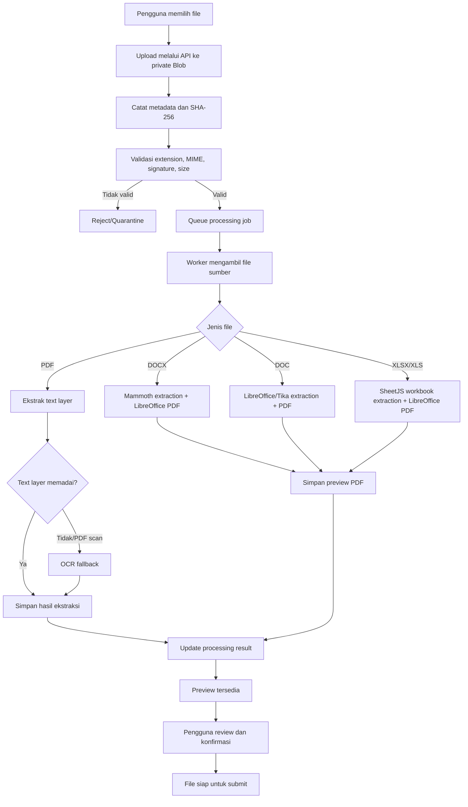

# Document Processing & Extraction

## Surat Digital

**Versi:** 1.3  
**Status:** Spesifikasi target; library dan hosting worker wajib melalui proof-of-concept

## 1. Tujuan

Dokumen ini menjelaskan cara Surat Digital menerima, memvalidasi, membaca, mengekstrak, mengonversi, menampilkan, dan menyimpan dokumen yang di-upload pengguna.

Format yang didukung:
- PDF
- DOCX
- DOC
- XLSX
- XLS

Tujuan utama bukan membuat AI yang memahami isi surat, melainkan:
1. Memastikan file valid dan aman.
2. Menghasilkan preview yang dapat diperiksa pengguna.
3. Mengekstrak teks dan struktur dasar untuk pencarian/arsip.
4. Mengonversi dokumen Office menjadi PDF representasi untuk review dan tanda tangan.
5. Menjaga file asli dan bukti integritas.

Ekstraksi teks bukan jaminan bahwa layout, tabel, gambar, atau makna dokumen dapat direkonstruksi sempurna. Pengguna tetap wajib memeriksa preview.

## 2. Prinsip wajib

- File asli tidak pernah ditimpa oleh hasil konversi.
- File asli disimpan di Vercel Blob dengan pola private access.
- Setiap file memiliki SHA-256, ukuran, MIME yang diklaim, dan MIME/signature yang terdeteksi.
- Processing dilakukan asynchronous melalui queue dan worker.
- NestJS API tidak menunggu OCR/konversi berat selesai dalam satu request.
- Satu file di-upload dan direview satu per satu.
- File tidak dapat dikonfirmasi atau disubmit sebelum validasi dan preview wajib selesai.
- Hasil OCR diberi label sebagai OCR dan dapat mengandung kesalahan.
- Tidak ada macro, script, embedded executable, atau active content yang dijalankan.
- Teks hasil ekstraksi dianggap sama sensitifnya dengan dokumen sumber.

## 3. Pipeline end-to-end

## 4. Library dan komponen yang direkomendasikan

| Kebutuhan | Kandidat | Peran dan batasan |
|---|---|---|
| PDF text extraction | `pdfjs-dist` | Membaca text layer PDF digital; tidak otomatis membaca gambar scan |
| DOCX extraction | `mammoth` | Mengekstrak teks/HTML dari DOCX; bukan renderer layout pixel-perfect |
| XLSX/XLS extraction | `xlsx` (SheetJS) | Membaca workbook, sheet, cell, formula, dan struktur dasar |
| DOC legacy extraction | LibreOffice headless atau Apache Tika | Membaca/mengekspor DOC lama; harus diuji dengan file perusahaan |
| Office-to-PDF | LibreOffice headless | Mengonversi DOC/DOCX/XLS/XLSX di worker/container |
| OCR | `tesseract.js` atau layanan OCR terkelola | Mengenali teks pada gambar/PDF scan; akurasi bergantung kualitas scan dan bahasa |
| File signature detection | `file-type` atau pemeriksaan signature setara | Memeriksa magic bytes, bukan hanya ekstensi/MIME dari browser |
| Malware scanning | ClamAV atau layanan scanning terkelola | Mendeteksi file berbahaya sebelum parsing/preview |

Versi library harus dipin di `package-lock.json`. Kandidat di atas bukan jaminan semua dokumen perusahaan akan terbaca sempurna. Lakukan proof-of-concept dengan sampel dokumen nyata yang telah disetujui untuk pengujian.

Referensi:
- [Mozilla PDF.js](https://mozilla.github.io/pdf.js/)
- [Mammoth.js](https://github.com/mwilliamson/mammoth.js)
- [SheetJS](https://docs.sheetjs.com/)
- [Tesseract.js](https://tesseract.projectnaptha.com/)
- [Apache Tika](https://tika.apache.org/)
- [LibreOffice](https://www.libreoffice.org/)

## 5. Pemrosesan per format

### 5.1 PDF digital

1. Validasi PDF signature dan ukuran.
2. Jalankan parser `pdfjs-dist`.
3. Ekstrak text layer per halaman.
4. Simpan urutan halaman dan teks.
5. Hitung jumlah halaman dan hash.
6. Buat preview PDF yang aman untuk ditampilkan.
7. Jika text layer tidak ada atau di bawah threshold yang dikonfigurasi, tandai sebagai kandidat PDF scan dan jalankan OCR fallback jika diaktifkan.

Batasan:
- PDF dengan font encoding rusak dapat menghasilkan teks tidak terbaca.
- Kolom, tabel, dan posisi visual dapat berbeda dari urutan teks hasil ekstraksi.
- PDF terenkripsi/password-protected perlu ditolak atau meminta versi yang dapat diproses sesuai kebijakan.

### 5.2 PDF scan

PDF scan berisi halaman gambar, bukan text layer yang dapat langsung diekstrak.

1. Worker merender halaman ke gambar pada resolusi yang dikonfigurasi.
2. OCR dijalankan menggunakan Tesseract.js atau provider yang dipilih.
3. Bahasa OCR minimal perlu dievaluasi untuk Bahasa Indonesia dan English.
4. Simpan teks per halaman dan metadata metode OCR.
5. Tampilkan label “Hasil OCR — perlu diperiksa”.
6. Jangan menganggap OCR sebagai sumber kebenaran untuk nomor surat, tanggal, nama, nilai, atau angka penting.

OCR individual pada file yang di-upload termasuk kemampuan target. OCR massal/backfill untuk seluruh arsip lama berada di luar MVP.

### 5.3 DOCX

1. Validasi file Office Open XML.
2. Ekstrak teks dan struktur dasar menggunakan `mammoth`.
3. Ekstrak heading/paragraf/tabel yang didukung.
4. Konversi file asli ke PDF menggunakan LibreOffice headless.
5. Simpan PDF sebagai rendered/preview object terpisah.
6. Creator memeriksa layout sebelum menerima file.

Batasan:
- `mammoth` bukan alat untuk merekonstruksi semua layout Word.
- Header/footer, floating objects, text boxes, SmartArt, font khusus, dan layout kompleks dapat memiliki keterbatasan.
- PDF hasil LibreOffice dapat berbeda dari Microsoft Word karena font, printer metrics, dan fitur yang tidak identik.

### 5.4 DOC legacy

DOC adalah format binary lama.

- Gunakan LibreOffice headless sebagai jalur konversi utama.
- Apache Tika dapat dipertimbangkan untuk ekstraksi teks jika hasil LibreOffice tidak memadai.
- Uji dokumen lama dengan tabel, gambar, header/footer, dan font khusus.
- Jika file tidak dapat diproses, tampilkan error yang jelas dan jangan menghapus file asli.

### 5.5 XLSX dan XLS

- Gunakan SheetJS (`xlsx`) untuk membaca workbook, nama sheet, cell values, formula, dan struktur dasar.
- Ekstraksi harus mempertahankan identitas sheet dan koordinat cell.
- Jangan mengeksekusi macro.
- Konversi ke PDF menggunakan LibreOffice headless.
- Berikan opsi/preview pengaturan sheet, orientasi, scaling, print area, dan page break jika diperlukan.
- Creator harus memeriksa hasil PDF, khususnya workbook banyak sheet atau tabel lebar.

Batasan:
- Data sel dan tampilan cetak adalah dua hal berbeda.
- Formula yang bergantung pada external links, macro, atau calculation engine khusus mungkin tidak menghasilkan nilai yang sama.
- Chart, pivot table, conditional formatting, dan object tertanam perlu diuji.

## 6. Validasi file dan keamanan

Validasi minimal:
1. Allowlist ekstensi PDF, DOCX, DOC, XLSX, XLS.
2. Periksa MIME type yang dikirim browser.
3. Deteksi signature/magic bytes di sisi server.
4. Pastikan ekstensi, MIME, dan signature konsisten.
5. Terapkan batas ukuran file.
6. Hitung SHA-256.
7. **Wajib** scan malware/quarantine sebelum parser; baseline fail-closed bila scan timeout/error.
8. Batasi ukuran hasil ekstraksi, jumlah halaman/sheet, decompressed archive size, CPU, RAM, dan waktu.
9. Jalankan worker non-root dan terisolasi.
10. Bersihkan temporary files.
11. Jangan mengeksekusi macro, embedded executable, atau script.
12. Jangan mengambil external links dari dokumen.
13. Jangan memasukkan file upload ke log atau error telemetry.

DOCX/XLSX merupakan container ZIP. Terapkan perlindungan zip bomb/decompression bomb. DOC/XLS lama dapat menggunakan compound binary format; jangan hanya mengandalkan MIME browser.

Batas angka konkret (maksimum MB, halaman, sheet, expanded bytes, timeout) belum ditentukan dan harus disepakati sebelum production.

## 7. Document Processing Worker dan queue

### Mengapa worker terpisah?

OCR dan LibreOffice dapat menggunakan CPU/RAM besar, membutuhkan binary sistem, temporary filesystem, serta waktu proses lebih panjang. NestJS API di Vercel harus menyelesaikan request upload/dispatch dengan cepat dan tidak menahan request sampai konversi selesai.

### Pola kerja

1. NestJS menerima file dan menyimpannya ke Vercel Blob.
2. NestJS membuat metadata dan `document_processing_jobs` melalui Prisma.
3. NestJS mengirim job ID ke queue.
4. Worker mengambil job dan mengunduh file dari private Blob menggunakan secret server-side.
5. Worker memvalidasi ulang dan menjalankan malware scan terlebih dahulu. Hanya status scan `PASS` yang boleh lanjut ke ekstraksi, OCR, dan/atau konversi.
6. Worker menyimpan preview PDF ke Blob.
7. Worker mengirim hasil melalui internal callback NestJS yang terautentikasi.
8. NestJS menyimpan extraction metadata/status melalui Prisma.
9. Frontend melakukan polling atau menerima notifikasi status.
10. Creator melakukan review dan konfirmasi.

Queue awal yang direkomendasikan: Redis + BullMQ. Provider Redis/queue final masih perlu dipilih. Queue hanya menyimpan job ID dan metadata minimum, bukan isi dokumen.

### Status job

- `QUEUED`
- `PROCESSING`
- `SUCCEEDED`
- `FAILED`
- `DEAD_LETTER`

Status file dapat mencakup:
- `UPLOADED`
- `VALIDATING`
- `PROCESSING`
- `PREVIEW_READY`
- `PENDING_REVIEW`
- `REVIEWED`
- `REJECTED`
- `FAILED`

### Reliability

- Gunakan idempotency key.
- Retry dengan jumlah terbatas dan backoff.
- Pindahkan job yang terus gagal ke dead-letter queue.
- Sediakan re-dispatch/retry yang diaudit.
- Pastikan job duplikat tidak membuat preview/extraction record ganda.
- Simpan parser/converter version.
- Gunakan **transactional outbox**: job/event outbox ditulis dalam transaksi yang sama dengan business/file state. Dispatcher/reconciliation mempublish ulang secara idempotent jika queue gagal.
- Jangan menghapus original file jika worker gagal.

## 8. Data yang disimpan

### `storage_objects`

Metadata objek Vercel Blob:
- provider, pathname/object key, content type, size, SHA-256, privacy/access mode, created_at.

### `document_files`

Metadata per file dalam versi dokumen:
- role MAIN/ATTACHMENT/RENDERED_PDF/FINAL_PDF.
- source storage object.
- detected MIME.
- file size.
- SHA-256.
- processing/review status.
- preview object reference.
- uploader, timestamp, review actor/timestamp.

### `document_processing_jobs`

- document file ID.
- job type.
- job status.
- attempt count.
- idempotency key.
- worker version.
- timestamps.
- sanitized error code dan correlation ID.

### `document_extractions`

- document file ID.
- parser name/version.
- extraction method.
- OCR language jika digunakan.
- extracted text.
- structured content JSONB untuk page/paragraph/table/sheet/cell.
- source SHA-256.
- created_at.

Extraction text sensitif. Akses harus melalui NestJS setelah pemeriksaan hak akses. Jangan membuka tabel extraction untuk pembacaan langsung oleh browser.

## 9. Review dan UX rules

- Satu file diproses dan direview sebelum pengguna melanjutkan file berikutnya.
- Preview harus tersedia untuk file yang memerlukan rendering.
- Tampilkan nama file, ukuran, format, halaman/sheet, status, dan waktu proses.
- Tampilkan pesan yang dapat ditindaklanjuti jika file gagal.
- Tampilkan label OCR pada teks yang diperoleh melalui OCR.
- Pengguna harus dapat melihat preview PDF hasil konversi Office.
- Pengguna harus menyatakan menerima hasil preview.
- Jika preview tidak sesuai, Creator dapat mengganti file sebelum submit.
- Setelah submit, file dan canonical version terkunci sesuai workflow.

## 10. API responsibilities

API publik:
- Upload satu file.
- Mendapatkan status processing.
- Mengambil preview setelah authorization.
- Mengonfirmasi review.
- Meminta retry processing jika diizinkan.

Internal worker API:
- Menerima callback job success/failure.
- Memverifikasi worker identity/secret dan idempotency.
- Menyimpan extraction metadata dan preview reference melalui Prisma.
- Menolak callback untuk file/job yang tidak cocok.

Jangan memberikan worker token, Blob token, database URL, atau service role ke frontend.

## 11. Testing

Test corpus minimal mencakup:
- PDF digital dengan teks.
- PDF scan berkualitas baik dan buruk.
- PDF multi-page.
- DOCX dengan paragraf, heading, tabel, gambar, header/footer.
- DOC legacy.
- XLSX/XLS dengan beberapa sheet, formula, print area, merged cells, chart, dan sheet tersembunyi.
- File corrupt.
- File extension/MIME/signature mismatch.
- File terlalu besar.
- ZIP bomb/decompression bomb.
- File dengan macro atau embedded active content.
- Simulasi worker timeout, crash, duplicate job, queue outage, dan Blob failure.

Kriteria:
- Original file tetap utuh.
- Hash konsisten.
- Preview tidak tersedia sebelum sukses.
- Retry idempotent.
- Error aman dan tidak membocorkan konten.
- User tidak dapat membaca extraction milik dokumen lain.
- File harus direview sebelum submit.
- Perbedaan rendering ditampilkan untuk diperiksa manusia.

## 12. Batasan yang diketahui

- Ekstraksi teks bukan pemahaman semantik dokumen.
- OCR dapat salah membaca huruf, angka, dan tanda baca.
- Parser DOCX tidak menjamin reproduksi layout Word.
- SheetJS membaca struktur workbook, tetapi bukan pengganti renderer spreadsheet.
- LibreOffice dapat menghasilkan layout berbeda dari Microsoft Office.
- Dokumen rusak, terenkripsi, sangat besar, atau memakai fitur kompleks mungkin ditolak.
- Integrasi AI untuk merangkum, mengklasifikasi, atau mengekstrak metadata semantik tidak termasuk dalam spesifikasi ini.

## 13. Open decisions

- Hosting worker/container.
- Queue provider.
- Versi library yang dipin.
- OCR engine/provider dan bahasa.
- Ukuran maksimal file, halaman, sheet, dan expanded archive.
- Timeout dan resource limits.
- Malware scanning provider.
- Retensi teks hasil ekstraksi.
- Strategi full-text search dan indexing.
- Pilihan sheet/print area Excel.

## 14. Malware scanning contract v1.2

Malware scanning bukan lagi keputusan opsional. Yang masih perlu POC hanyalah engine/provider, kapasitas, signature update, dan timeout. Contract:

1. File masuk status `QUARANTINED`/`SCANNING` setelah upload.
2. Parser/LibreOffice/OCR dilarang membaca konten sampai scan `PASS`.
3. `DETECTED` menghasilkan rejection/quarantine dan security audit tanpa mengekspos detail sensitif kepada pengguna biasa.
4. `ERROR/TIMEOUT` mengikuti fail-closed: file tetap tidak diproses dan dapat diretry sesuai policy.
5. Scanner dan converter berjalan dengan resource/network isolation yang disetujui.
6. Test environment menggunakan harmless scanner fixture/signature test yang disetujui, bukan malware nyata.

## 15. Canonical PDF dan Document Manifest

Untuk file Office, hasil conversion yang telah direview menjadi canonical PDF reference untuk versi tersebut. Canonical Document Manifest menggabungkan canonical PDF hash, attachment hashes, issuer/type metadata, document/version IDs, dan manifest version. Manifest dibuat/di-hash di backend pada atomic Sign+Submit; worker tidak boleh mengganti canonical input setelah lock.

## 16. Billing interaction — v1.3

Document processing adalah technical work dan **bukan** credit event tersendiri pada baseline v1.3. Malware scan, conversion retry, OCR retry, preview regeneration, dan finalization retry tidak boleh membuat debit Document Credit tambahan.

Credit hanya di-consume oleh business event yang didefinisikan pada `20_Credit_Billing_and_Pricing.md`. Dengan demikian kegagalan provider/worker tidak mengalihkan biaya retry teknis kepada customer secara tidak terduga.
